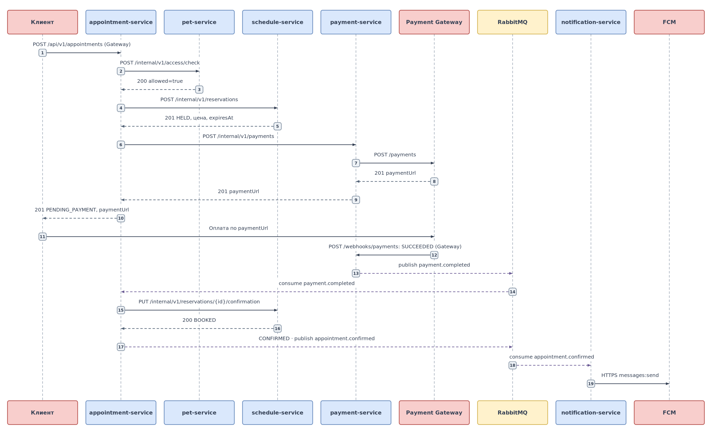
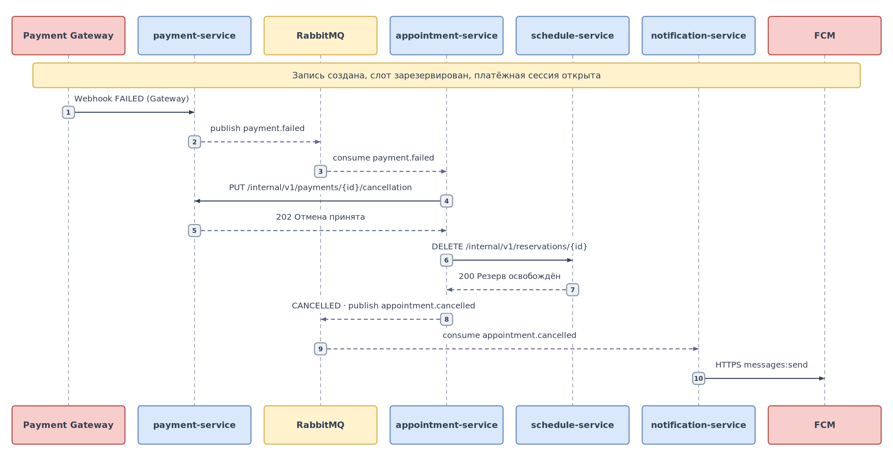

# Pet Care — уход за питомцами и ветеринарные приёмы

## ЛР3. Декомпозиция и проектирование микросервисной системы

## 1. Анализ предметной области

### 1.1. Описание системы

Pet Care помогает владельцам домашних животных планировать повседневный уход и записываться в ветеринарную клинику. Администратор формирует расписание врачей, владелец выбирает время и вносит предоплату за посещение. После приёма ветеринар оформляет назначения, а владелец видит их в календаре и отмечает выполнение. Система отправляет уведомления о записях и напоминания о приёмах лекарств.

### 1.2. Акторы

| Актор | Действия |
|---|---|
| Владелец (`OWNER`) | Управляет своими питомцами, делами и календарём, записывается на приём, оплачивает и отменяет запись, просматривает назначения |
| Ветеринар (`VET`) | Просматривает свои записи и историю пациента, завершает приём, оформляет назначения |
| Администратор клиники (`CLINIC_ADMIN`) | Создаёт слоты врачей, просматривает и отменяет записи |
| Платёжный шлюз (PSP) | Создаёт платёжные сессии, передаёт результат оплаты, выполняет отмены и возвраты |
| Firebase Cloud Messaging (FCM) | Принимает push-уведомления для доставки владельцам |

Keycloak и API Gateway — инфраструктурные компоненты. Владелец работает только со своими питомцами; ветеринар — с пациентами назначенных ему посещений. Администратор не получает медицинскую историю.

### 1.3. Пользовательские сценарии

1. Как владелец, я хочу создавать профили питомцев, чтобы вести данные отдельно для каждого животного.
2. Как владелец, я хочу планировать дела и отмечать выполнение, чтобы вести историю ухода.
3. Как владелец, я хочу выбрать свободный слот и оплатить посещение, чтобы записаться к ветеринару.
4. Как владелец, я хочу отменить запись до начала посещения, чтобы получить возврат предоплаты.
5. Как администратор, я хочу создавать непересекающиеся слоты и просматривать записи, чтобы организовать расписание клиники.
6. Как ветеринар, я хочу видеть свои записи и историю пациента, чтобы подготовиться к посещению.
7. Как ветеринар, я хочу завершить приём и оформить курс лечения, чтобы владелец получил назначения.
8. Как владелец, я хочу видеть дела и назначения в календаре, получать напоминания и отмечать приёмы лекарств, чтобы контролировать выполнение курса.

## 2. Доменные события и ограниченные контексты

### 2.1. Event Storming

| Контекст | Сущности | Доменные события |
|---|---|---|
| Питомцы и уход | Питомец, дело, отметка | ПитомецСоздан, ДелоЗапланировано, ДелоВыполнено, КалендарьОбновлён |
| Расписание | Слот, резерв | СлотСоздан, СлотЗарезервирован, РезервИстёк, РезервПодтверждён, РезервОсвобождён |
| Записи | Запись, состояние саги | ЗаписьСоздана, ЗаписьПодтверждена, ЗаписьОтменена, ПриёмЗавершён |
| Оплата | Платёж, возврат | ПлатёжСоздан, ОплатаПрошла, ОплатаОтклонена, ВозвратВыполнен |
| Здоровье | Курс, приём лекарства | КурсНазначен, ПриёмЛекарстваОтмечен |
| Уведомления | Устройство, задание, попытка | УстройствоЗарегистрировано, НапоминаниеЗапланировано, УведомлениеПереданоПровайдеру |

Доменные события — уже произошедшие факты. Через брокер передаются только события, необходимые другим контекстам (раздел 6).

### 2.2. Глоссарии

| Контекст | Термины |
|---|---|
| Питомцы и уход | **Питомец** — профиль с постоянным UUID; **владелец** — пользователь, чей идентификатор берётся из `sub` токена; **дело** — запланированное бытовое действие; **отметка** — факт выполнения; **календарь** — дела и копия расписания лечения |
| Расписание | **Слот** — интервал времени врача с ценой; **резерв** — временное исключительное удержание слота; **TTL** — срок удержания (до 15 минут); **бронь** — подтверждённый резерв |
| Записи | **Запись** — намерение владельца посетить врача; **посещение** — завершённый приём; **сага** — последовательность локальных транзакций с компенсациями; **снимок слота** — время, врач и стоимость в записи |
| Оплата | **Платёж** — предоплата записи; **сессия** — ссылка для оплаты; **callback** — подписанный результат PSP; **возврат** — операция возврата списанной суммы |
| Здоровье | **Курс** — назначенный врачом препарат, доза и расписание; **приём лекарства** — один экземпляр расписания; **факт приёма** — отметка TAKEN или SKIPPED; **история** — ранее оформленные назначения |
| Уведомления | **Устройство** — зарегистрированный push-токен; **задание** — запланированная отправка; **попытка** — обращение к FCM; **SENT** — сообщение принято провайдером, а не обязательно прочитано |

### 2.3. Различия моделей

В `pet-service` питомец — полный профиль, в `appointment-service` и `health-service` — идентификатор связи. В расписании цена принадлежит слоту, в записи и платеже хранится снимок суммы. В контексте записей «приём» означает посещение клиники, в контексте здоровья — приём лекарства.

## 3. Карточки сервисов и варианты разбиения

Расчётная нагрузка: одна клиника, 10 врачей, 500 владельцев, до 100 посещений в день, пик до 20 клиентских запросов/с. Задержки ниже — проектные цели, не результаты нагрузочных испытаний. Каждый сервис владеет отдельной БД; ссылки на чужие UUID не являются межбазовыми внешними ключами.

| Сервис | Ответственность и данные | Предоставляет | Зависимости | Нефункциональные требования | Обоснование границы |
|---|---|---|---|---|---|
| `pet-service` | Профили, владелец, дела, отметки, медицинская проекция; `pet_db` | Профили, дела, календарь, проверка владельца | Подписан на `health.*` | 20 проверок/с, p95 ≤ 100 мс; проекция ≤ 5 с | Профиль и уход принадлежат одному владельцу, имеют общие правила доступа |
| `schedule-service` | Слоты, резервы, отметки отмены; `schedule_db` | Создание/поиск слотов, удержание, подтверждение, освобождение, `slot.expired` | Брокер | 15 чтений/с, p95 ≤ 200 мс; один действующий резерв на слот | Конкуренция за ограниченный ресурс и TTL — отдельные бизнес-правила |
| `appointment-service` | Записи, этапы саги, снимки слотов и статусы оплаты; `appointment_db` | Запись, статус, отмена, завершение, доступ врача, `appointment.*` | pet, schedule, payment; `payment.*`, `slot.expired` | 5 записей/с, p95 создания ≤ 2 с при доступных зависимостях; высокая критичность | Владеет посещением и координирует процесс, но не временем врача или деньгами |
| `payment-service` | Платежи, возвраты, callback; `payment_db` | Создание, отмена, статус, webhook, `payment.*` | PSP, брокер | 5 операций/с; защита подписи, отсутствие повторных списаний | Независимый финансовый жизненный цикл, внешний провайдер и аудит |
| `health-service` | Курсы лечения и факты приёмов; `health_db` | Назначение, история, расписание, отметки, `health.*` | pet, appointment | 5 запросов/с, p95 ≤ 500 мс; защита медицинских данных | Медицинские назначения не зависят от дальнейших записей или оплаты |
| `notification-service` | Токены, задания, история отправок; `notification_db` | Регистрация устройства, список уведомлений | health, FCM; `appointment.*`, `health.*` | 60 отправок/мин; обработка в течение 60 с от срока | Ошибки внешней доставки не блокируют записи и назначения |

### Отвергнутые варианты

- Отдельный `care-service`: дела и профили имеют общего владельца и одинаковую проверку доступа. Объединены в `pet-service`, чтобы уменьшить связность.
- Объединение записей и расписания: резервирование ограниченного времени врача имеет отдельные правила конкуренции и истечения срока, запись координирует оплату и посещение.
- Объединение записей и здоровья: финансовые и медицинские данные имеют разные жизненные циклы и правила доступа.
- Объединение оплаты и уведомлений с другими сервисами: внешние интеграции имеют независимые сбои, повторы и состояния.
- Общая БД: связывает сервисы через чужие таблицы и миграции.

## 4. Выбор готового ПО

| Компонент | Сервисы | Обоснование |
|---|---|---|
| PostgreSQL | Все 6 сервисов, отдельные БД | Транзакции для резервов, платежей и outbox, ограничения уникальности и связи внутри контекста |
| RabbitMQ | schedule, appointment, payment, health, pet, notification | Topic exchange маршрутизирует события нескольким получателям; очереди, подтверждения и DLQ обеспечивают повторную обработку |
| Nginx | API Gateway | Единый HTTPS-вход, маршрутизация публичных API, запрет доступа к `/internal/*` |
| Keycloak | Клиент и сервисы | OIDC, JWT с ролями и `sub`, сервисные токены для внутренних вызовов |
| PSP | payment | Создание платёжной сессии, callback, отмена и возврат без хранения карточных данных |
| FCM | notification | Доставка push по токенам устройства |
| Docker Compose | Все компоненты | Изолированные процессы и сеть, независимые хранилища и единый запуск |

В PostgreSQL достаточно транзакций и ограничений для защиты слотов, отдельный Redis не требуется. RabbitMQ выбран вместо Kafka, так как основная задача — маршрутизация событий небольшого потока, а не хранение большого журнала для аналитики. Фактически используемые компоненты ЛР4 приведены в разделе 8.

## 5. Схемы взаимодействий

### 5.1. Архитектурная схема

[Редактируемый draw.io](docs/architecture.drawio) · [SVG](docs/architecture.svg)


Сплошные стрелки — синхронные запросы (REST/HTTPS/SQL), пунктирные — события брокера. Клиент обращается к API через Gateway; страница оплаты находится у PSP. Внешний webhook также проходит через Gateway. В sequence-диаграммах серый пунктир означает ответ на запрос, фиолетовый — событие брокера. JWT проверяется сервисами с использованием ключей Keycloak; прямого доступа к чужим БД нет.

### 5.2. Синхронные взаимодействия

| Инициатор → получатель | Эндпоинт | Назначение |
|---|---|---|
| appointment → pet | `POST /internal/v1/access/check` | Проверка владельца питомца |
| appointment → schedule | `POST /internal/v1/reservations` | Удержание слота |
| appointment → schedule | `PUT /internal/v1/reservations/{appointmentId}/confirmation` | Подтверждение резерва |
| appointment → schedule | `DELETE /internal/v1/reservations/{appointmentId}` | Освобождение резерва |
| appointment → payment | `POST /internal/v1/payments` | Платёжная сессия |
| appointment → payment | `PUT /internal/v1/payments/{appointmentId}/cancellation` | Отмена или возврат |
| appointment → payment | `GET /internal/v1/payments/{appointmentId}` | Проверка статуса оплаты |
| health → appointment | `GET /internal/v1/appointments/{appointmentId}/access` | Проверка доступа врача |
| health → pet | `POST /internal/v1/access/check` | Проверка доступа владельца |
| notification → health | `GET /internal/v1/health/occurrences/{occurrenceId}` | Проверка актуальности напоминания |
| payment → PSP | HTTPS: `POST /payments`, отмена/возврат | Интеграция платёжного провайдера |
| PSP → Gateway → payment | `POST /webhooks/payments` | Результат оплаты |
| notification → FCM | HTTPS: `messages:send` | Отправка push |

### 5.3. Успешный сценарий — запись с предоплатой



[Draw.io](docs/sequence-success.drawio) · [SVG](docs/sequence-success.svg)

1. Владелец отправляет `POST /api/v1/appointments` с `petId`, `slotId` и `Idempotency-Key`. appointment проверяет владельца через pet и сохраняет запись `PREPARING`.
2. schedule атомарно удерживает свободный слот до `min(now + 15 минут, startAt)`, возвращает цену, врача и срок. appointment сохраняет снимок.
3. payment создаёт платёжную сессию у PSP. appointment возвращает `201 Created`, `PENDING_PAYMENT` и `paymentUrl`. Оплата ещё не завершена.
4. Владелец оплачивает по ссылке. PSP передаёт подписанный callback. payment фиксирует результат и публикует `payment.completed`.
5. appointment получает событие, подтверждает резерв в schedule (`BOOKED`), сохраняет `CONFIRMED` и публикует `appointment.confirmed`. notification отправляет push через FCM.

После посещения врач завершает запись. health проверяет назначенного врача и статус `COMPLETED`, сохраняет курс и расписание, публикует `health.course.created`. pet обновляет календарь, notification создаёт напоминания. Отметка приёма лекарства публикует `health.occurrence.completed`.

### 5.4. Сбой оплаты и компенсация



[Draw.io](docs/sequence-failure.drawio) · [SVG](docs/sequence-failure.svg)

При отказе PSP сервис payment сохраняет `FAILED` и публикует `payment.failed`. appointment переходит в `CANCELLING`, закрывает платёжную сессию и освобождает резерв. После подтверждения компенсаций запись становится `CANCELLED`, а notification получает `appointment.cancelled`. Если списание не произошло, возврат не нужен. При отмене уже оплаченного посещения до его начала возвращается вся предоплата.

| Сбой | Действие системы |
|---|---|
| Владелец не подтверждён / pet недоступен | 403 / 503, резерв и платёж не создаются |
| Слот занят или запрос резервирования не завершился | 409 / 503; запись отменяется, проверяются и компенсируются потенциально выполненные операции |
| Не удалось создать платёжную сессию | Закрыть попытку платежа и освободить резерв; при недоступности участника повторять компенсацию |
| Потерян ответ создания записи | Повтор с тем же ключом возвращает прежний результат, второй платёж не создаётся |
| Оплата отклонена | `payment.failed`, закрытие платежа, освобождение слота, `CANCELLED` |
| Резерв истёк | schedule освобождает слот и публикует `slot.expired`; appointment также проверяет срок самостоятельно |
| Оплата пришла после отмены | payment выполняет возврат; запись остаётся `CANCELLED` |
| Ответ подтверждения резерва потерян | Повтор по appointmentId; уже подтверждённый резерв возвращается без повторной брони |
| Сбой координатора / компенсации | Промежуточное состояние сохранено; незавершённая подготовка и компенсации обрабатываются при восстановлении |
| Повтор события / недоступен брокер | Outbox, повтор публикации; inbox и допустимые переходы состояния защищают от повторного действия |
| FCM недоступен | Повторы отправки; состояние записи и лечения не откатывается |

Сага оркестрируется appointment. В schedule резерв меняется транзакционно; освобождение затрагивает только резерв конкретной записи. Сохранённая отметка отмены не позволяет запоздалому запросу создать тот же резерв или платёж заново. `CANCELLED` — статус посещения; финансовый статус может оставаться `REFUND_PENDING` до подтверждения возврата.

## 6. Интеграционные события

| Routing key | Издатель | Подписчики | Схема |
|---|---|---|---|
| `payment.completed` | payment | appointment | `PaymentCompleted` |
| `payment.failed` | payment | appointment | `PaymentFailed` |
| `payment.refunded` | payment | appointment | `PaymentRefunded` |
| `slot.expired` | schedule | appointment | `SlotExpired` |
| `appointment.confirmed` | appointment | notification | `AppointmentConfirmed` |
| `appointment.cancelled` | appointment | notification | `AppointmentCancelled` |
| `health.course.created` | health | pet, notification | `HealthCourseCreated` |
| `health.occurrence.completed` | health | pet, notification | `HealthOccurrenceCompleted` |

[AsyncAPI 2.6.0 — схемы и примеры](api/events.yaml). Topic exchange `pet-care.events`; отдельные очереди appointment, pet, notification. Конверт события: `eventId`, `eventType`, `occurredAt`, `schemaVersion`, `correlationId`, `payload`.

Изменение данных и запись в outbox выполняются одной транзакцией. Отдельный обработчик публикует событие; потребитель подтверждает обработку после сохранения результата. Inbox хранит обработанные `eventId`, а `correlationId` связывает запросы и события одной операции. При ошибке обработки сообщение повторяется до трёх раз, затем попадает в DLQ. Проекция календаря и напоминания обновляются асинхронно; конечная отметка лекарства не перезаписывается запоздалым событием создания курса.

## 7. Контракты API

| Сервис | OpenAPI 3.0.3 |
|---|---|
| pet | [pet-service.yaml](api/pet-service.yaml) |
| schedule | [schedule-service.yaml](api/schedule-service.yaml) |
| appointment | [appointment-service.yaml](api/appointment-service.yaml) |
| payment | [payment-service.yaml](api/payment-service.yaml) |
| health | [health-service.yaml](api/health-service.yaml) |
| notification | [notification-service.yaml](api/notification-service.yaml) |
| События | [events.yaml](api/events.yaml) |

Общие правила: публичные API помечены `public`, межсервисные — `internal`, callback PSP — `webhook`. Публичный доступ по JWT, внутренний по сервисному токену; локальные заглушки описаны альтернативными схемами авторизации. Ошибки имеют единый формат `application/problem+json`: `type`, `title`, `status`, `detail`, `code`, `correlationId`. Повторяемые операции требуют `Idempotency-Key`: тот же ключ с другим телом возвращает 409. В списках `page`, `size`, `total`, `items`; размеры страниц 1–100. Идентификаторы UUID, даты в UTC, денежные суммы в копейках.

Проверка структуры и примеров: `python -m pytest tests/test_contracts.py -q`. Для независимой проверки OpenAPI и AsyncAPI:

```bash
npx --yes @redocly/cli lint --extends minimal api/*-service.yaml
npx --yes @asyncapi/cli validate api/events.yaml
```

Каждый OpenAPI можно импортировать в [Swagger Editor](https://editor.swagger.io/). Результаты выполненных проверок: [validation.txt](docs/validation.txt).

---

## ЛР4. Реализация микросервисов

## 8. Реализация, локальный запуск и демонстрация

### 8.1. Стек и структура

Python 3.12+ и FastAPI: компактные HTTP-сервисы, простая обработка JSON, удобная маршрутизация и Swagger. HTTPX используется для межсервисных HTTP-запросов. SQLite обеспечивает транзакции и отдельные файлы данных без запуска отдельной СУБД. JSON Schema проверяет тела запросов и параметры по тем же OpenAPI-контрактам, которые находятся в `api/`.

```text
├── api/             # 6 OpenAPI + AsyncAPI
├── docs/            # схемы и результаты проверок
├── services/        # pet, schedule, appointment, payment, health, notification
├── gateway/         # HTTP-маршрутизация
├── shared/          # HTTP, валидация, SQLite, события и бизнес-правила
├── mocks/           # broker, psp, fcm
├── postman/         # коллекция и окружение
├── scripts/run.py   # локальный запуск отдельных процессов
├── tests/           # unit, контракты и интеграционные тесты
├── Dockerfile
└── docker-compose.yml
```

### 8.2. Реализованные сервисы

| Сервис | Порт | Хранилище |
|---|---:|---|
| pet | 8001 | `pet.sqlite` |
| schedule | 8002 | `schedule.sqlite` |
| appointment | 8003 | `appointment.sqlite` |
| payment | 8004 | `payment.sqlite` |
| health | 8005 | `health.sqlite` |
| notification | 8006 | `notification.sqlite` |
| Gateway | 8080 | — |
| Mock broker / PSP / FCM | 8010 / 8011 / 8012 | Очереди в памяти / отдельные файлы SQLite |

Все 31 операция шести OpenAPI-спецификаций имеют обработчики. Каждый бизнес-сервис запускается отдельным процессом и работает только со своим файлом SQLite. Gateway проксирует публичные запросы и webhook, не пропускает `/internal/*`.

### 8.3. Реальные взаимодействия и моки

| Компонент или взаимодействие | Реализация |
|---|---|
| Gateway → сервисы и все внутренние REST-вызовы из раздела 5.2 | Реальные HTTP-запросы между отдельными процессами |
| События раздела 6 | Отдельный брокер-заглушка: публикация по routing key, очереди подписчиков, получение независимо от HTTP-запроса, ack/nack, DLQ |
| PostgreSQL | Отдельная SQLite-БД на сервис, транзакции |
| Nginx | FastAPI Gateway-прокси |
| Keycloak | Заголовки `X-User-Id`, `X-Role`, `X-Service` вместо JWT; проверка роли и доступа к объекту сохранена |
| Платёжный шлюз | Отдельный HTTP-мок PSP. Результат выбирается в Postman, мок отправляет подписанный webhook через Gateway |
| FCM | Отдельный HTTP-мок, принимающий push и записывающий его в журнал |

Мок-авторизация не предназначена для внешнего доступа. Брокер хранит очереди в памяти: при его перезапуске уже принятые сообщения могут быть потеряны. Outbox бизнес-сервисов хранится в SQLite. Реальные платежи и push не выполняются.

### 8.4. Идемпотентность, ошибки и логирование

Повтор POST с тем же ключом не создаёт вторую запись, повтор финансовой операции использует тот же идентификатор платежа. Ключи и ответы сохраняются в SQLite. Повтор callback определяется по `providerEventId`, повтор события — по `eventId`. Обработчики проекций сохраняют inbox и локальные данные одной транзакцией; координатор саги использует сохранённые этапы и идемпотентные действия участников.

Все бизнес-API возвращают ошибки `application/problem+json`. Gateway создаёт `X-Correlation-Id` и передаёт его дальше. Логи содержат название сервиса, correlationId, входящий запрос (`RECEIVED`), межсервисный вызов (`REST`), публикацию (`PUBLISH`), получение (`CONSUME`) и изменения состояний.

### 8.5. Локальный запуск

В корне репозитория (Python 3.12 или 3.13):

```bash
python3 -m venv .venv
source .venv/bin/activate
pip install -r requirements.txt
python scripts/run.py
```

Gateway доступен по `http://localhost:8080/health`. Команда запускает все процессы и выводит их логи в терминал. `Ctrl+C` останавливает систему. Данные находятся в `.data/`, логи — в `.logs/`. Если порт 8080 занят, можно запустить с `--port-offset 10000` и поменять `baseUrl` в Postman на `http://localhost:18080`.

Альтернативный запуск через Docker Compose:

```bash
docker compose up --build -d
docker compose logs -f
# остановка
docker compose down
```

Gateway — единственный контейнер с опубликованным портом. Для просмотра отдельных логов: `docker compose logs -f appointment schedule payment broker notification`.

### 8.6. Демонстрация через Postman

Импортировать [коллекцию](postman/Pet-Care.postman_collection.json) и [окружение](postman/Pet-Care.postman_environment.json), выбрать окружение `Pet Care`. Запросы в папках выполняются вручную сверху вниз. Идентификаторы питомца, слотов и записей сохраняются автоматически. Для повторной демонстрации с чистыми данными после остановки можно запустить `python scripts/run.py --data-dir .data/second-demo`; старые данные сохранятся.

| Папка | Что проверить |
|---|---|
| 0. Подготовка | Gateway, питомец, устройство, два свободных слота |
| 1. Успешная запись | 201 `PENDING_PAYMENT`, повтор с тем же ключом, результат PSP `SUCCEEDED`, затем `CONFIRMED` |
| 2. Отказ оплаты | 201 `PENDING_PAYMENT`, результат PSP `FAILED`, затем `CANCELLED`, слот снова свободен |
| 3. Уход и доступ | Дело, отметка выполнения, календарь, 403 для чужого питомца |
| 4. Назначение | Отдельный короткий слот, оплата, завершение визита врачом, курс, отметка приёма и календарь |

Между callback и GET статуса нужно дождаться обработки событий (обычно 1–3 секунды). При необходимости повторить GET. Во время демонстрации держать открытым терминал с логами. Краткое описание: [docs/demo-scenarios.md](docs/demo-scenarios.md).

### 8.7. Тестирование

```bash
python -m pytest -q
```

Тесты проверяют пересечение слотов, срок резерва, формирование курса, транзакцию outbox, параметры и примеры контрактов. Интеграционные тесты сами запускают отдельные процессы с временными БД и проверяют успешную запись, отказ оплаты, повтор запроса, права доступа, возврат, позднюю оплату, конкурентную бронь и обновление календаря. Фактические результаты: [validation.txt](docs/validation.txt).
