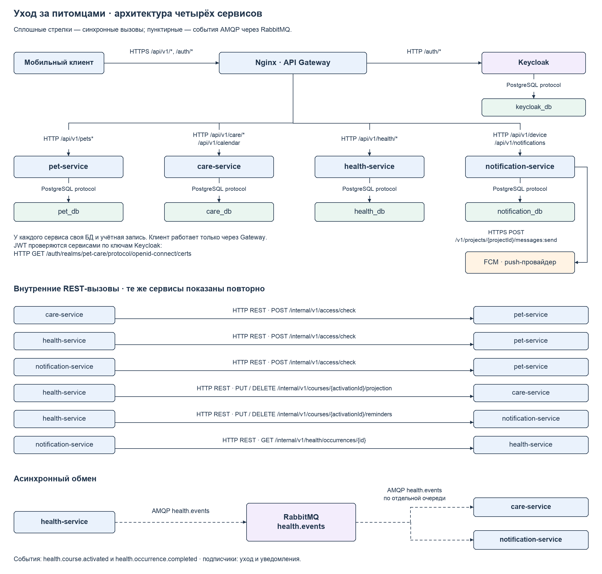

# Лабораторная работа №3. Декомпозиция и проектирование микросервисной системы

## 1. Описание предметной области, акторы, пользовательские сценарии

Система помогает владельцу домашнего животного планировать уход и выполнять введённые назначения ветеринара. Пользователь создаёт профиль питомца и отмечает кормления, прогулки и другие повседневные дела. Для курса лечения приложение формирует расписание приёмов, показывает его в календаре и отправляет напоминания. История фактических действий сохраняется отдельно от планов; отсутствие отметки не означает, что действие выполнено или лекарство пропущено.

| Актор | Действия |
|---|---|
| Владелец | Управляет только своими питомцами, создаёт дела и курсы, отмечает выполнение, регистрирует устройство для напоминаний. |
| Keycloak | Выполняет вход пользователя и выдаёт JWT. |
| Firebase Cloud Messaging (FCM) | Принимает запросы на доставку push-уведомлений. |

### Пользовательские сценарии

1. Как владелец, я хочу создать профиль питомца, чтобы связывать с ним дела и назначения.
2. Как владелец, я хочу запланировать кормление или прогулку, чтобы видеть предстоящий уход.
3. Как владелец, я хочу отметить выполненное дело, чтобы сохранить историю ухода.
4. Как владелец, я хочу запустить курс с введённой дозой и расписанием, чтобы видеть предстоящие приёмы лекарства.
5. Как владелец, я хочу получать напоминания и отмечать приём лекарства, чтобы следить за выполнением курса.
6. Как владелец, я хочу видеть дела ухода и приёмы лекарства в одном календаре, чтобы планировать день.

## 2. Доменные события и ограниченные контексты с глоссариями

| Контекст | Сущности | Доменные события |
|---|---|---|
| Питомцы | Питомец, владелец | ПитомецСоздан |
| Уход | Дело, отметка выполнения, медицинская проекция | ДелоЗапланировано, ДелоВыполнено, ПроекцияКурсаПодготовлена |
| Здоровье | Курс, приём лекарства, операция активации | КурсСоздан, КурсАктивирован, АктивацияКурсаОтменена, ПриёмОтмечен |
| Уведомления | Устройство, напоминание, попытка отправки | УстройствоЗарегистрировано, НапоминанияПодготовлены, УведомлениеПереданоПровайдеру |

### Питомцы

| Термин | Значение |
|---|---|
| Питомец | Профиль животного с постоянным идентификатором. |
| Владелец | Единственный пользователь, которому принадлежат профиль и доступ к истории питомца. |
| Проверка доступа | Проверка совпадения владельца питомца с идентификатором пользователя из JWT. |

### Уход

| Термин | Значение |
|---|---|
| Дело | Однократное действие ухода с названием и запланированным временем. |
| Выполнение | Факт завершения дела с фактическим временем; повторная отметка не создаёт второй факт. |
| Медицинская проекция | Копия расписания и статусов приёмов для календаря; изменять медицинские факты через неё нельзя. |

### Здоровье

| Термин | Значение |
|---|---|
| Курс | Название лекарства, введённая доза, первый приём, интервал в часах и конечное число приёмов. |
| Приём | Один экземпляр расписания: ожидает отметки, принят или явно пропущен пользователем. |
| Активация | Операция подготовки календаря и напоминаний перед переводом курса в активное состояние. |

### Уведомления

| Термин | Значение |
|---|---|
| Устройство | Push-токен одного текущего устройства пользователя. |
| Напоминание | Задание отправки для конкретного приёма лекарства и его владельца. |
| Попытка отправки | Обращение к FCM и его результат; принятие провайдером не гарантирует прочтение. |

## 3. Карточки сервисов и отвергнутые варианты разбиения

Расчётная нагрузка: 100 пользователей, 300 питомцев, до 10 клиентских запросов в секунду. Задержки указаны для нормальной работы зависимостей.

### pet-service

| Поле | Описание |
|---|---|
| Название | `pet-service` |
| Ответственность | Хранит профили питомцев и проверяет владение. |
| Владеет данными | Питомец, `ownerId`; отдельная база `pet_db`. |
| Предоставляет | Создание, список и чтение питомцев; внутренний `POST /internal/v1/access/check`. |
| Зависит от | Keycloak для проверки JWT; другие бизнес-сервисы не вызывает. |
| Нефункциональные требования | До 10 проверок/с, p95 ≤100 мс. Высокая критичность: при сбое проверки доступ не разрешается. |
| Обоснование границы | Один источник владения для всей системы; изменение профиля не затрагивает медицинские данные. |

### care-service

| Поле | Описание |
|---|---|
| Название | `care-service` |
| Ответственность | Ведёт дела ухода и объединённый календарь. |
| Владеет данными | Дела, факты их выполнения; база `care_db`. Медицинская проекция принадлежит сервису только как копия. |
| Предоставляет | Создание, список и выполнение дел; чтение календаря; внутренние подготовка и удаление проекции курса. |
| Зависит от | Вызывает `pet-service`; получает `health.course.activated` и `health.occurrence.completed`. |
| Нефункциональные требования | До 5 запросов/с, p95 ≤500 мс. Уникальная отметка выполнения. Обновление проекции обычно ≤5 с. |
| Обоснование границы | Повседневные дела имеют собственный жизненный цикл; чтение календаря не требует вызова здоровья. |

### health-service

| Поле | Описание |
|---|---|
| Название | `health-service` |
| Ответственность | Ведёт курсы и факты приёмов, координирует активацию курса. |
| Владеет данными | Курсы, расписания, факты приёмов, состояния операций и outbox; база `health_db`. |
| Предоставляет | Создание и чтение курсов, активация, статус операции, список и отметки приёмов; внутреннее чтение приёма; два события из раздела 6. |
| Зависит от | Вызывает `pet-service`, `care-service` и `notification-service`; публикует сообщения в RabbitMQ. |
| Нефункциональные требования | До 3 запросов/с, p95 обычного запроса ≤500 мс. Активация возвращает `202` без ожидания остальных сервисов. Высокая критичность сохранения фактов. |
| Обоснование границы | Назначение и факт приёма имеют одного владельца. Медицинские правила не смешиваются с бытовым уходом. |

### notification-service

| Поле | Описание |
|---|---|
| Название | `notification-service` |
| Ответственность | Готовит и отправляет напоминания о приёмах лекарства. |
| Владеет данными | Токены устройств, задания и результаты отправки; база `notification_db`. |
| Предоставляет | Регистрация текущего устройства и список напоминаний; внутренние подготовка и отмена заданий курса. |
| Зависит от | Вызывает `pet-service`, `health-service` и FCM; получает оба события здоровья. |
| Нефункциональные требования | До 30 отправок/мин, начало обработки задания ≤60 с после назначенного времени. Сбой доставки не откатывает курс или факт приёма. |
| Обоснование границы | Внешняя доставка требует собственных повторов и учёта ошибок; её нагрузка независима от записи медицинских фактов. |

| Отвергнутый вариант | Причина |
|---|---|
| Объединить здоровье и уведомления | Ошибки внешнего push-провайдера будут связаны с сохранением назначения и истории. |
| Выделить календарь с собственными медицинскими расписаниями | Появятся два редактируемых источника одного назначения. Календарь использует проекцию. |
| Общая база для сервисов | Сервисы станут зависеть от чужих таблиц и миграций. Каждый подключается только к своей БД. |

## 4. Таблица выбранного ПО с обоснованием

| Компонент | Кто использует | Обоснование |
|---|---|---|
| PostgreSQL | Все четыре сервиса; отдельная БД и учётная запись для каждого | Транзакции сохраняют данные и outbox атомарно; уникальные ограничения предотвращают повторную отметку и обработку сообщения. |
| RabbitMQ | Здоровье, уход, уведомления | Durable-очереди сохраняют сообщения при недоступности подписчиков. Publisher confirms, ручные подтверждения и DLQ позволяют повторять обработку. |
| Nginx | Мобильный клиент и публичные API | Единый HTTPS-вход, маршруты `/api/v1/*` и `/auth/*`. Внутренние API не публикуются. JWT проверяют сервисы. |
| Keycloak | Все сервисы | Вход через OpenID Connect с PKCE; пароли не хранятся в бизнес-сервисах. Keycloak использует свою служебную БД. |
| FCM | Уведомления | Доставка push по токену устройства; сервис учитывает ошибки провайдера и недействительные токены. |
| Docker Compose | Сервисы и инфраструктура | Общая внутренняя сеть, отдельные контейнеры и тома БД; можно перезапустить один сервис, сохранив его данные. |

## 5. Архитектурная схема, диаграммы последовательности, таблица взаимодействий

[Исходник всех схем](docs/architecture.drawio)

Клиент обращается только к Gateway. У каждого бизнес-сервиса своя БД; прямые обращения к чужим таблицам запрещены. Сплошные стрелки — синхронные вызовы, пунктирные — события RabbitMQ.

| Инициатор → получатель | Тип | Метод и путь / событие | Назначение |
|---|---|---|---|
| Уход → питомцы | REST | `POST /internal/v1/access/check` | Проверка владельца при работе с делами. |
| Здоровье → питомцы | REST | `POST /internal/v1/access/check` | Проверка владельца курса. |
| Уведомления → питомцы | REST | `POST /internal/v1/access/check` | Проверка владельца перед отправкой. |
| Здоровье → уход | REST | `PUT /internal/v1/courses/{activationId}/projection` | Подготовить скрытую проекцию. |
| Здоровье → уведомления | REST | `PUT /internal/v1/courses/{activationId}/reminders` | Подготовить отключённые задания. |
| Здоровье → уход | REST | `DELETE /internal/v1/courses/{activationId}/projection` | Компенсировать подготовку проекции. |
| Здоровье → уведомления | REST | `DELETE /internal/v1/courses/{activationId}/reminders` | Компенсировать подготовку заданий. |
| Уведомления → здоровье | REST | `GET /internal/v1/health/occurrences/{id}` | Проверить актуальность приёма перед отправкой. |
| Здоровье → уход, уведомления | AMQP | `health.course.activated` | Показать проекцию и включить задания. |
| Здоровье → уход, уведомления | AMQP | `health.occurrence.completed` | Обновить календарь и отменить напоминание. |
| Уведомления → FCM | HTTPS | `POST /v1/projects/{projectId}/messages:send` | Отправить push. |

### Сквозной сценарий: запуск курса с напоминаниями

Курс задаётся первым приёмом, интервалом в часах и числом приёмов от 1 до 60. Все моменты хранятся в UTC; клиент отображает их в местном времени. Курс создаётся в `DRAFT`; его параметры после создания не редактируются. Расписание и UUID приёмов сохраняются в здоровье, поэтому повторы подготовки передают одинаковые данные.

1. Клиент вызывает `POST /api/v1/health/courses/{id}/activations` с `Idempotency-Key`. Здоровье проверяет владельца, фиксирует операцию и `PREPARING`, возвращает `202` и `operationId`.
2. Фоновый обработчик здоровья вызывает подготовку проекции в уходе, затем подготовку отключённых напоминаний в уведомлениях. Один `activationId` используется во всей попытке.
3. После двух успешных ответов здоровье одной транзакцией переводит курс в `ACTIVE`, операцию в `SUCCEEDED` и сохраняет `health.course.activated` в outbox. Это точка фиксации решения.
4. Подписчики получают событие: уход показывает расписание, уведомления включают задания. `SUCCEEDED` означает фиксацию курса; отображение и включение заданий происходят с небольшой задержкой.
5. Пользователь отмечает приём в здоровье. Событие `health.occurrence.completed` обновляет проекцию и отменяет оставшееся напоминание этого приёма.

### Сбой и компенсация

Если подготовка любого участника не завершилась за 30 с, здоровье переводит операцию в `COMPENSATING`. Координатор вызывает оба `DELETE`, даже если результат одного `PUT` неизвестен. Уход удаляет скрытую проекцию, уведомления отменяют подготовленные задания. Только после обоих подтверждений курс возвращается в `DRAFT`, операция становится `FAILED`; исходное назначение сохраняется.

| Сбой | Поведение |
|---|---|
| Проверка доступа или сохранение начальной операции | Запрос отклоняется, курс остаётся `DRAFT`. При недоступности проверки возвращается `503`. |
| Ответ на запрос активации потерян | Повтор с тем же `Idempotency-Key` возвращает ту же операцию. Другая незавершённая активация курса запрещена (`409`). |
| Подготовка проекции либо напоминаний завершилась ошибкой или таймаутом | Повтор с тем же `activationId`; после срока подготовки — компенсация обоих участников. |
| `DELETE` пришёл раньше запоздавшего `PUT` | Участник сохраняет отметку отмены `activationId`, даже если данных ещё нет. Поздний `PUT` получает `409` и не восстанавливает данные. |
| Участник недоступен во время компенсации | Координатор повторяет отмену; операция остаётся `COMPENSATING`, успешное завершение не объявляется. |
| Координатор перезапущен | Продолжает операцию из сохранённого состояния; одинаковые `PUT` и `DELETE` безопасны при повторении. |
| Ошибка фиксации `ACTIVE` | Координатор перечитывает состояние БД. Если транзакция зафиксирована — доставляет событие; если нет — продолжает подготовку либо компенсацию. |
| После `ACTIVE` недоступен брокер или подписчик | Outbox и очередь повторяют доставку. Автоматического отката активного курса нет. |
| Событие выполнения пришло раньше события активации | Подписчик сохраняет конечный статус приёма. Активация не сбрасывает отметку и не включает уже отменённое напоминание. |
| FCM не отвечает или токен устройства недействителен | Временная ошибка повторяется с задержкой 30 с в пределах часа от назначенного времени; недействительный токен отключается. Факт приёма не откатывается. |

Внутренний REST-вызов имеет таймаут 2 с. Подготовка повторяется с задержкой 2 с в пределах 30 с; компенсация — с задержкой 10 с до подтверждения. Один обработчик захватывает операцию в БД, чтобы конкурентные обработчики не приняли разные решения. Завершённый отказ допускает новую попытку с новым ключом и `activationId`.

Данные здоровья и outbox сохраняются одной транзакцией. Получатель одной транзакцией обновляет данные и записывает обработанный `eventId`, затем подтверждает сообщение. Доставка — как минимум один раз; `correlationId` связывает сообщения с операцией, но не заменяет дедупликацию по `eventId`. После трёх ошибок обработчика сообщение попадает в DLQ для исправления причины и повторного запуска. Данные не удаляются из очереди как успешно обработанные при ошибке.

Перед push уведомления повторно проверяют владельца и статус приёма в здоровье. Если приём уже отмечен, задание отменяется; если зависимость недоступна, отправка откладывается. Просроченное более чем на час напоминание не отправляется. Повтор FCM после потери ответа может дать дублирующий push; запись приёма остаётся уникальной. Отсутствие устройства не мешает подготовке курса, но отправка без токена завершается ошибкой.

## 6. Перечень событий: топик, издатель, подписчики, ссылка на схему

| Exchange / routing key | Издатель | Подписчики | Схема |
|---|---|---|---|
| `health.events` / `health.course.activated` | health-service | care-service, notification-service | [CourseActivated](api/health-service.yaml#/components/schemas/CourseActivated) |
| `health.events` / `health.occurrence.completed` | health-service | care-service, notification-service | [OccurrenceCompleted](api/health-service.yaml#/components/schemas/OccurrenceCompleted) |

RabbitMQ использует durable topic exchange `health.events`; очереди `q.care.health` и `q.notification.health` подписаны на оба ключа. У каждой очереди своя DLQ. Издатель ждёт publisher confirm, сообщения публикуются как persistent.

Конверт содержит `eventId`, `eventType`, `occurredAt`, `schemaVersion`, `correlationId`, `payload`. Для активации полезная нагрузка содержит `activationId`, `courseId`, `petId`; расписание уже сохранено участниками через REST. Для отметки — `occurrenceId`, `courseId`, `petId`, `status` (`TAKEN` или `SKIPPED`) и `recordedAt`. Статус приёма меняется только один раз из `PENDING` в конечный; это упрощает обработку повторов и перестановки сообщений.

## 7. Ссылки на OpenAPI-файлы

- [pet-service.yaml](api/pet-service.yaml)
- [care-service.yaml](api/care-service.yaml)
- [health-service.yaml](api/health-service.yaml)
- [notification-service.yaml](api/notification-service.yaml)
